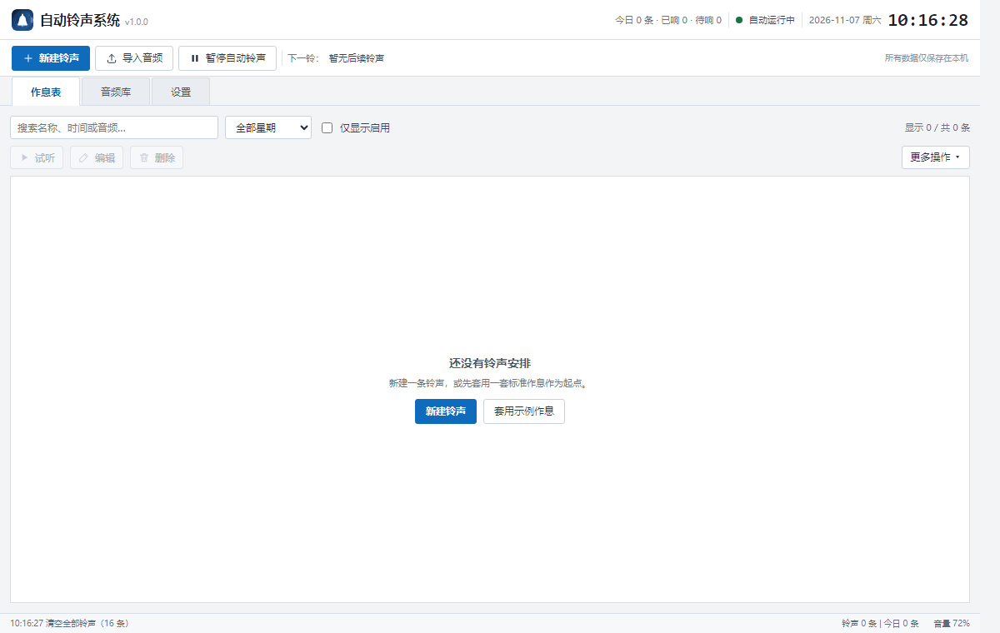
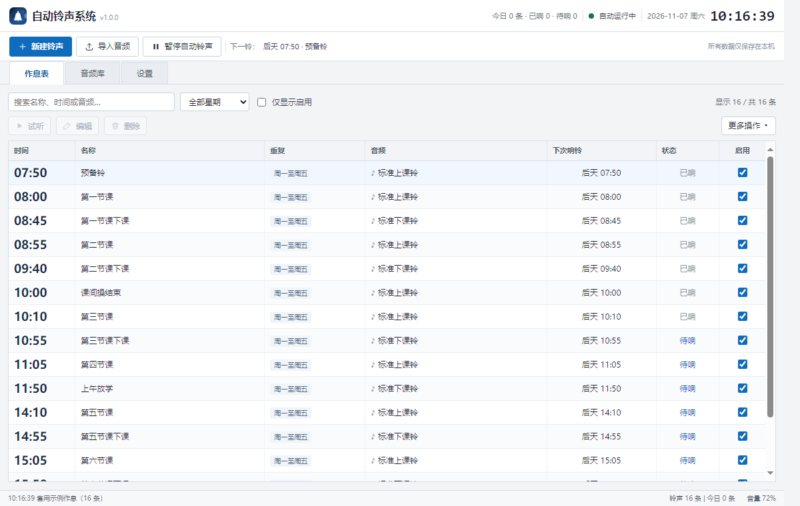
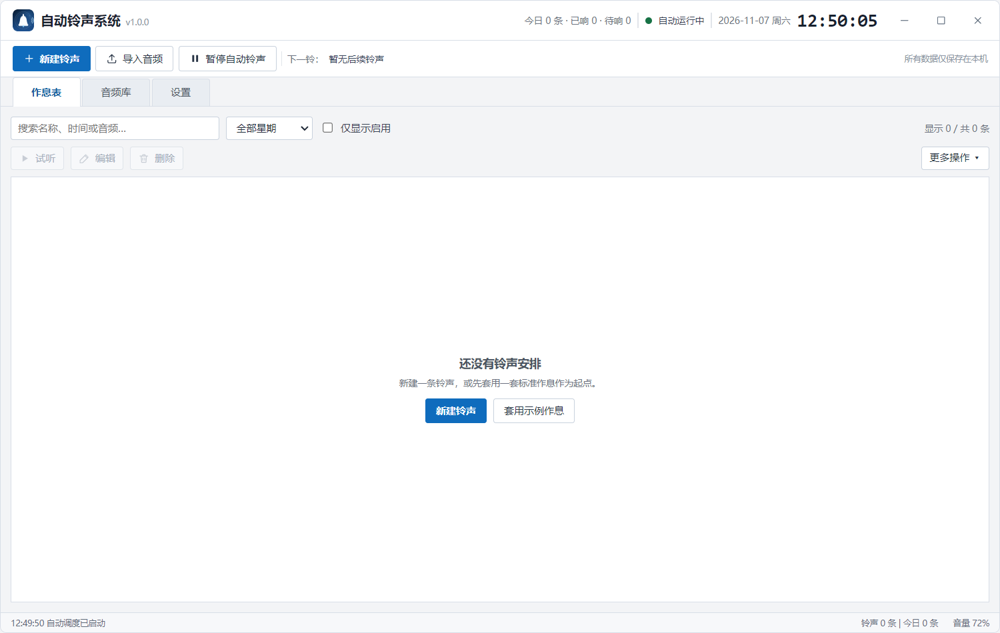
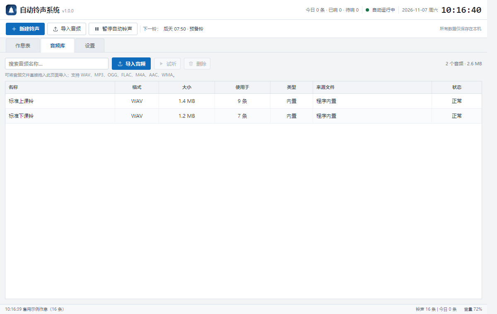
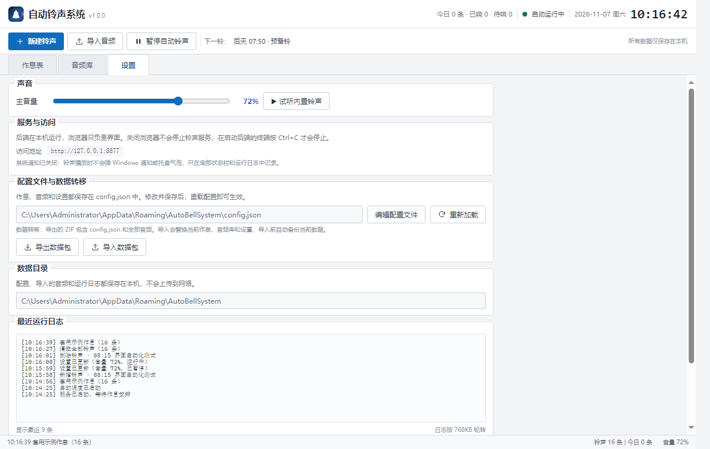

# 自动铃声系统（Web + 桌面 EXE）

前后端分离的校园自动打铃系统。后端是纯 Python 服务，前端是独立静态 Web GUI；既可以直接在浏览器中使用，也可以用 Electron 打包为无默认窗口边框的 Windows 桌面 EXE。



## 架构

```text
浏览器 Web GUI (frontend/)
        │  fetch REST / 每秒轮询状态
        ▼
FastAPI / Uvicorn (backend/api.py)
        │
        ▼
BellService（状态、调度、配置、导入导出）
   ├─ BellScheduler  后台线程，200ms 检查
   ├─ AudioPlayer    pygame / SDL_mixer 播放
   └─ Storage        JSON 配置 + audio/ + backups/
```

- **后端**：Python 3.10+，FastAPI、Uvicorn、pygame-ce。
- **前端**：原生 HTML/CSS/JavaScript，无需 Node.js，无构建步骤。
- **界面**：沿用上一版桌面端的视觉设计，包括顶部状态栏、工具栏、三个标签页、紧凑表格、分组设置和右下角状态栏。
- **默认空作息**：首次运行只有两段内置钟声，不预置任何铃声。
- **安静运行**：没有浏览器通知、没有系统托盘气泡，播放铃声只在底部状态栏和日志中记录。



## 运行

```powershell
cd auto-bell-web
python -m pip install -r requirements.txt
python run.py
```

浏览器会自动打开 `http://127.0.0.1:8765`。也可以手动访问：

```text
http://127.0.0.1:8765
```

不自动打开浏览器：

```powershell
python run.py --no-browser
```

修改端口：

```powershell
python run.py --port 9000
```

Windows 下也可以双击 `start.bat`，或执行：

```powershell
powershell -ExecutionPolicy Bypass -File .\run.ps1
```

> 后端服务需要保持运行。关闭浏览器不会停止铃声服务；在启动服务的终端按 `Ctrl+C` 才会停止。

## 桌面 EXE

桌面版把「Electron 窗口 + 内置 Python 后端 + Web GUI」打包成一个安装程序：

```text
交付包：AutoBellSystem-Setup-1.0.0.exe
```

这个交付 EXE 是一个单文件安装引导器：内置真正的 Inno Setup 安装程序，
启动时把它释放到 `%LOCALAPPDATA%\AutoBellSetupCache`，并把安装器的
`TEMP`/`TMP` 指向该目录，避免 Windows 用户 Temp 目录权限异常导致
`Setup was unable to create the directory ... Error 5`。

- 安装到 `%LOCALAPPDATA%\Programs\AutoBellDesktop`，无需管理员权限。
- 无 Windows 默认标题栏：顶部栏即自绘标题栏，包含拖动区域和最小化/最大化/关闭按钮。
- 窗口内容使用 8px 小圆角；窗口本身改为**不透明背景**，避免 Windows 10 把透明边距绘制成黑框。
- 双击顶部栏也可最大化/还原；窗口大小和位置会记住。
- 关闭窗口会同时结束后端进程；不会留下后台服务。
- 安装包内置的初始数据同样是空作息，只带两段内置钟声。



桌面版数据放在程序目录旁的 `AutoBellData\data`（安装版即
`%LOCALAPPDATA%\Programs\AutoBellDesktop\AutoBellData\data`），
整个程序目录可以直接复制迁移；如果该目录不可写，会自动回退到用户数据目录。

桌面版使用一个极小的原生启动器 `自动铃声系统.exe`，由它带参数启动内置的
`AutoBellDesktop.exe`，避免部分 Windows/安全软件环境下 Electron 沙箱导致
启动失败；启动器本身也使用应用图标。

### 从源码重新构建

首次需要安装 Electron 依赖：

```powershell
cd desktop
npm install
cd ..
```

然后一条命令完成「测试 → 后端 → Electron → 启动器 → 安装包 → 单文件安装引导器」：

```powershell
powershell -ExecutionPolicy Bypass -File .\build.ps1
```

也可以跳过测试：

```powershell
powershell -ExecutionPolicy Bypass -File .\build.ps1 -SkipTests
```

构建产物：

```text
dist-electron\自动铃声系统-1.0.0-安装程序.exe    Inno Setup 内层安装器
dist-electron\AutoBellSystem-Setup-1.0.0.exe      交付用单文件安装引导器
```

## 功能

- 顶部状态栏：今日数量、运行状态、日期时间、下一铃。
- 作息表：时间、名称、重复星期、音频、下次响铃、状态、启用复选框；搜索和星期筛选。
- 新建/编辑：时间下拉、名称、星期复选、音频选择、试听、启用状态。
- 音频库：导入、搜索、试听、删除；显示格式、大小、使用次数、来源和文件状态。
- 配置：可在网页内直接编辑 `config.json`，保存并严格校验后立即生效；也可重新加载磁盘上的配置。
- 数据转移：导出包含配置和全部音频的 ZIP；导入前自动备份当前数据，失败时不影响原数据。
- Web 版数据路径：`%APPDATA%\AutoBellSystem`；桌面 EXE 数据路径：程序目录旁 `AutoBellData\data`。
- 后端提供 Swagger 文档：`http://127.0.0.1:8765/docs`。





## API 概览

| 方法 | 路径 | 说明 |
| --- | --- | --- |
| GET | `/api/state` | 完整界面状态、下次铃、播放状态、日志 |
| GET/PUT | `/api/config` | 读取/保存配置（保存后严格校验并应用） |
| POST | `/api/config/reload` | 从磁盘重新加载配置 |
| POST/GET | `/api/schedules` | 新建 / 列出作息 |
| PUT/DELETE | `/api/schedules/{id}` | 修改 / 删除 |
| PATCH | `/api/schedules/{id}` | 启用或停用 |
| DELETE | `/api/schedules` | 清空全部作息 |
| POST | `/api/schedules/template` | 套用示例作息 |
| POST | `/api/schedules/{id}/preview` | 试听某条铃声 |
| POST | `/api/audios` | 上传音频（multipart） |
| DELETE | `/api/audios/{id}` | 删除音频（内置/使用中禁止） |
| POST | `/api/audios/{id}/preview` | 试听音频 |
| PATCH | `/api/settings` | 修改音量/暂停状态 |
| POST | `/api/stop` | 停止当前播放 |
| GET | `/api/export` | 下载数据包 ZIP |
| POST | `/api/import` | 上传并导入数据包 ZIP |

## 配置文件

首次运行生成：

```text
%APPDATA%\AutoBellSystem\config.json
```

配置结构：

```json
{
  "version": 1,
  "audios": [
    {"id": "builtin-up", "name": "标准上课铃", "filename": "builtin_up.wav", "builtin": true}
  ],
  "schedules": [
    {"id": "example-0800", "time": "08:00", "name": "第一节课", "audio_id": "builtin-up", "weekdays": [1,2,3,4,5], "enabled": true}
  ],
  "settings": {"volume": 72, "paused": false}
}
```

- 时间：24 小时制 `HH:MM`。
- 星期：`1` 到 `7` 表示周一到周日。
- `audio_id` 必须引用 `audios` 中的 `id`。
- 完整示例见 [`docs/config.example.json`](docs/config.example.json)。
- 默认运行状态为空作息；示例仅用于说明字段。

编辑方式：

1. 设置 → 配置文件与数据转移 → 编辑配置文件
2. 保存并应用，后端会严格校验 JSON 和引用关系
3. 也可以直接改磁盘文件，再点「重新加载」

## 数据目录与迁移

```text
%APPDATA%\AutoBellSystem\
├─ config.json                 作息与设置
├─ config.json.bak             上一次配置备份
├─ audio\                      导入的音频 + 内置钟声
├─ backups\before-import-*.zip 导入前自动备份
├─ backups\export-*.zip        导出数据包
└─ logs\autobell.log           运行日志
```

换电脑：设置 → 导出数据包，把 ZIP 拷到新电脑，安装后端后在设置里导入。

## 测试

```powershell
python -m pip install -r requirements-dev.txt
python -m unittest discover -s tests -v
```

当前包含 8 项 API 集成测试，覆盖首次空状态、作息 CRUD、配置重载、音频上传/试听、数据包导入导出和调度播放。

覆盖：

- 首次启动为空作息+内置音频
- 作息 CRUD、重复时间校验、启停
- 音量/暂停设置与配置文件重载
- 音频上传、删除、试听和停止
- 示例作息
- 导出 ZIP 后再导入、自动备份
- 非法配置拒绝且不破坏当前数据
- 调度线程按时播放

## 目录

```text
auto-bell-web/
├─ run.py                 启动入口（浏览器自动打开）
├─ start.bat / run.ps1    Windows 启动脚本
├─ backend/
│  ├─ api.py              FastAPI 路由
│  ├─ service.py          业务状态、调度、配置、数据包
│  ├─ player.py           pygame 音频播放
│  ├─ storage.py          配置/音频/ZIP 数据包
│  ├─ models.py           数据模型
│  ├─ chime.py            内置钟声
│  ├─ constants.py
│  └─ paths.py
├─ frontend/
│  ├─ index.html
│  ├─ styles.css
│  └─ app.js
├─ assets/audio/          内置 WAV
├─ docs/                  配置示例与截图
├─ tests/                 API 集成测试
└─ requirements.txt
```

## 说明

- 本次按要求**不打包**，只提供可运行的 Python 后端和 Web 前端源码。
- 前端不依赖外部 CDN、无网络请求。
- 音频格式支持取决于 pygame/SDL_mixer 与系统解码器，建议优先 WAV/MP3。
- 浏览器只作为界面，铃声由后端播放；因此后端所在电脑必须保持开机且未休眠。
